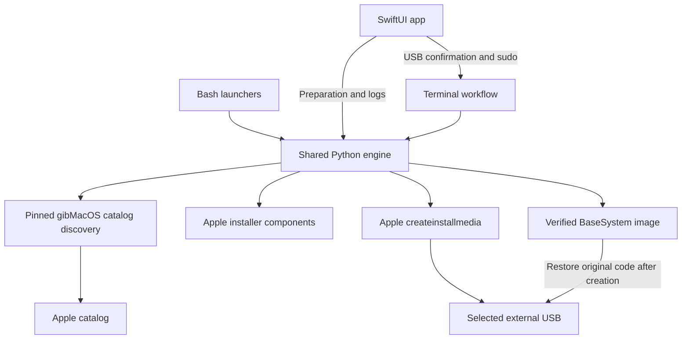

# Architecture

## Shared engine

`engine/macos_usb.py` uses Python 3.9+ and the standard library. It delegates
catalog discovery for High Sierra through Catalina to a pinned gibMacOS dependency downloaded inside the work
folder. The Bash launchers call its `all`, `download`, or `usb` subcommands.
The Swift app bundles a copy of this engine and calls the same interfaces.

The Bash interface is not an independent pure-Bash downloader, and the Swift
app is not a Python-free native rewrite. Sharing one engine keeps matching
product selection, disk validation, privilege boundaries, and repair behavior
consistent. No npm/pip packages or Swift package dependencies are required.

## Preparation and integrity

For the catalog route, one product supplies all required components. Catalog SHA-1 is checked
when present. For a mismatch with available integrity metadata, a CNKL manifest
is fetched from an Apple HTTPS URL and every SHA-256 chunk is compared, including
the total length and absence of trailing bytes. The embedded manifest signature
is not independently validated. Direct Apple distribution DMGs use HTTPS and
their embedded disk-image checksum; no unpublished catalog digest is invented
for that route. Local import trust depends on the supplied original installer.
Missing/incorrect catalog data is not accepted solely
because a filename or size looks correct.

Catalog assembly is used for High Sierra, Mojave, and Catalina. Earlier direct
Apple DMGs are mounted read-only; `pkgutil --expand-full` extracts their package
without executing installer scripts. An app/outer DMG/PKG can also be supplied
locally. Mavericks needs that local-source route. Bare ESD images are rejected
by the import interface.

The assembled app is staged, validated, and renamed into place on success.
Interrupted `.part` files remain in the work folder. The disk budget accounts
for complete cached files, remaining downloads, an assembled copy, and reserve.
`MACOS_USB_WORKDIR` overrides the default root; each release has a subfolder.
It is also how the app selects its Application Support work root without writing
into its app bundle. Existing Catalina prototype data is recognized separately
when no new root is set. `--download-files-only` stops before extraction/assembly;
`--download-only` finishes preparation but never writes a USB.

## Privileges and disk operations

The program runs as the normal user. Only specific copy/format/media commands
use sudo, after confirmation. Internal, non-whole, virtual, unknown, read-only,
and undersized targets are rejected. The disk metadata is checked again after
confirmation and sudo. Existing one-volume GUID/HFS+ layouts are reused; other
layouts are partitioned on the confirmed whole disk.

Lion and Mountain Lion restore their original InstallESD image using `asr`,
with image verification before erasure and a boot-file existence check after
restoration. No signature repair is applied to those image-restore releases.
Modern hosts may not support every legacy restore; hardware validation is needed.

USB creation always erases media. `--check-only` never erases the USB, although
host downloads/signatures may change. Privacy authorization is controlled by
macOS; neither sudo nor this tool grants TCC permissions. The user must grant
removable-volume access to the actual app/terminal when required.

For Mavericks through Catalina, the local Intel host utility can be re-signed to execute on Apple Silicon.
This is distinct from the Apple-signed installer code required on the target.
After media creation, original app code from BaseSystem is merged onto the USB
without replacing SharedSupport. Local imports preserve an original app skeleton
for this step. Executable byte comparisons and matching
signature metadata check this restoration; they do not constitute full payload
or boot/install verification. Keep original downloads for repair.

## Native app

SwiftUI manages release/source choices and the visible workflow; AppKit supplies folder selection and
launches Terminal. Foundation Process streams preparation logs. Disk choices
come from diskutil's plist metadata and are rechecked by the backend. The app
never selects the first disk automatically.

With `MACOS_USB_EVENTS=1`, backend stdout includes `::progress::` JSON records.
Each record contains `stage`, `detail`, `current`, and `total`; null counters
denote indeterminate progress. Download byte counts, checksum/assembly bytes,
and reported USB percentages are measured for the current step. There is no
synthetic overall completion percentage. The Swift UI parses complete records
from the live stream or Terminal log while retaining the raw log for diagnosis.

Creation and repair use a generated, shell-quoted `.command` file with mode
0700 in the work folder. It launches the same engine, tees output to a local
log, and writes an exit-status marker. The app monitors those files. There is
no password field or privileged helper inside the app. The app is not built
with the App Sandbox entitlement because the workflow requires disk tooling
and user-selected privileged operations.

## Known boundaries

- Apple can change/remove catalog products and download endpoints.
- Hardware compatibility is governed by Apple; this is not a patcher.
- A workspace-root flock prevents simultaneous use of the same data across
  releases, not access to a USB from different work roots or other programs.
- Unexpected unplugging, forced termination, lack of power, and media faults
  can leave an incomplete USB. There is no automatic erasure/retry loop.
- Shell and Swift tests use fixtures/mocks and do not prove bootability.
- Full installation success must be established on the intended target Mac.
